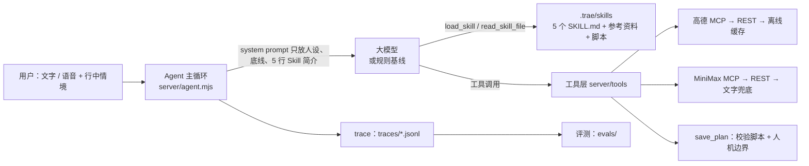

# 杭州随身导游 Agent

给第一次来杭州的自由行游客（主打「带父母出游」）的随身导游：**行前**一句话排出顺路的行程，**行中**边走边讲、遇到下雨或走累了随时改计划，**行后**生成回忆卡片。

技术上由三部分组成：
- **5 个 Agent Skills**（`SKILL.md`，开放标准）：沉淀导游的经验
- **高德 MCP + MiniMax 语音**：提供地图和语音能力
- **评测集 + 调用链路 trace**：形成迭代闭环

> 年初版（「查景点 → 合成音频 → 生成网页」的固定工作流）保留在 [`legacy/`](legacy/)，方便对比。

---

## 快速开始

```bash
npm install
cp .env.example .env     # 可以先什么都不填
npm start                # 打开 http://localhost:3001
```

**不填任何 key 也能完整演示**：
- 大模型自动退回「规则基线」
- 地图用离线景点表估算
- 语音降级为文字，页面上可以改用浏览器朗读

填上 key 之后，先跑连通性自检：

```bash
npm run check
```

| 变量 | 用途 |
|---|---|
| `LLM_API_KEY` / `LLM_BASE_URL` / `LLM_MODEL` | 任何 OpenAI 兼容、支持 tool calling 的模型（MiniMax、DeepSeek、通义、Kimi） |
| `AMAP_KEY` | 高德 Web 服务 Key，高德 MCP 和 REST 降级共用 |
| `MINIMAX_API_KEY` | MiniMax 语音；不填 `LLM_API_KEY` 时也用它调 MiniMax 大模型 |

## 2 分钟演示脚本

| 步骤 | 操作 | 要讲的点 |
|---|---|---|
| 1 | 点「周六带爸妈玩一天西湖，我妈膝盖不好」 | 加载了 trip-planner；台阶多的灵隐寺被排除；步行量 ≤ 5 km 由脚本校验；卡片上写着「我假设了……」 |
| 2 | 只说「周六带爸妈玩一天西湖」 | 只追问一个问题（走路情况），日期不用问 |
| 3 | 点右侧「确认行程」，再说「去掉第二站」 | 已确认的行程不会被直接改，而是给出「修改 / 保持原样」两个选项 |
| 4 | 展开「行中模拟器」，位置选断桥残雪，点「我们到断桥了，讲讲」 | 长辈版讲解；只用知识卡里的事实；先查缓存，没命中再合成语音 |
| 5 | 时间改成 10:30，点「下雨了」 | 进入 replan，给出两个方案；用户选了才改 |
| 6 | 点「雷峰塔是哪一年倒的？」，再问「灵隐寺大雄宝殿是哪年重修的？」 | 知识卡里有的直接答；没有的说「不确定」，不编 |
| 7 | 点「帮我做个今天的回忆」 | trip-card-ui 生成可转发的 H5 卡片 |
| 8 | 切到「调用链路」 | 每轮命中的 Skill、每次工具调用、耗时、数据来源、成本 |

## 架构



**渐进式披露**：
- 平时上下文里只有每个 Skill 的一行 `description`；
- 模型判断出意图后才 `load_skill` 读正文；
- 需要资料时再 `read_skill_file`。

**规则基线**（`server/providers/rule.mjs`）：它和大模型用的是同一套 Skill 文件、同一套工具、同一份 trace，只是把「选 Skill、选工具」换成了关键词和规则。作用有两个：
- 没有 key 也能演示；
- 评测时作为 baseline，回答面试题「为什么要用大模型做路由」。

## 目录

```
.trae/skills/                  # Agent Skills（Trae / Claude Code / Cursor 等都能直接读）
  trip-planner/                #   行程规划：SKILL.md、景点表、validate_plan.mjs
  spot-narrator/               #   景点讲解：SKILL.md、风格、10 张带出处的知识卡
  replan/                      #   应急调整：SKILL.md、雨天备选表
  local-food/                  #   周边吃喝：SKILL.md、筛选规则、离线餐厅缓存
  trip-card-ui/                #   行程呈现：SKILL.md、H5 卡片模板
mcp.json                       # 高德 MCP + MiniMax MCP（和 Trae 用的是同一份配置）
server/
  agent.mjs                    # 主循环：选 Skill → 调工具 → 追问/给方案就停下
  prompt.mjs                   # System Prompt（人设 + 底线 + Skill 索引 + 当前状态）
  skills.mjs                   # Skill 加载器（frontmatter、渐进式披露、防路径穿越）
  tools/                       # 16 个工具：Skill 元工具 / 高德 / 语音 / 交互与行程状态
  providers/                   # openai.mjs（大模型）、rule.mjs（规则基线）、nlu.mjs
  memory.mjs  trace.mjs        # 偏好记忆、调用链路
public/                        # 前端：对话 + 行中模拟器 + 行程 / 链路 / 记忆面板
evals/                         # cases.jsonl（33 条）、run_evals.mjs、results/
scripts/                       # check_services.mjs、pregen_narrations.mjs
legacy/                        # 年初版
```

## 关键决策在代码里的位置

| 决策 | 怎么做的 | 代码 |
|---|---|---|
| 追问最多 2 个问题 | SKILL.md 写规则；`ask_user` 只接受前 2 个问题，调用后本轮结束 | `trip-planner/SKILL.md`、`server/tools/plan.mjs` `askUser` |
| 模型出方案，脚本做校验 | `save_plan` 必定先跑 `validate_plan.mjs`，检查时间衔接、开放时间、闭馆日、步行量、台阶、雨天室内比例；不通过就把错误交回模型，最多改 2 轮 | `trip-planner/scripts/validate_plan.mjs`、`plan.mjs` `savePlan` |
| 已确认的行程不能擅自改 | **代码层硬约束**：没有用户选择的 approval，`save_plan` 直接拒绝，并要求先 `propose_options` | `plan.mjs` `savePlan` / `applyChoice` |
| 地图兜底 | 高德 MCP（重试 1 次）→ 高德 REST → 本地景点表估算；返回值带 `source`，卡片上标「估算」 | `server/tools/amap.mjs` `tiered` |
| 语音兜底 | MiniMax MCP → REST → 只返回文字；前端提供浏览器朗读 | `server/tools/voice.mjs` |
| 大模型兜底 | 本轮第一次调用失败，整轮退回规则基线，并提示用户 | `server/agent.mjs` |
| 讲解不编造 | 只读知识卡；SKILL.md 写明禁止项；评测里检查「讲解中的数字都能在知识卡里找到」 | `spot-narrator/`、`evals/run_evals.mjs` |
| 成本 | 讲解用 hd、对话用 turbo；讲解按「景点:风格」缓存；`npm run pregen` 预生成；每轮最多 12 步工具调用 | `voice.mjs`、`scripts/pregen_narrations.mjs`、`config.mjs` |
| 隐私 | 记忆只允许写白名单字段（同行人、体力、口味……），不存位置；页面上可以查看和删除 | `server/memory.mjs` |
| 不代办 | 订票、打车、支付只给官方或高德的 URI 链接 | System Prompt 底线、各 SKILL.md |

## 评测

```bash
npm run eval:rule                 # 规则基线
npm run eval                      # .env 里配置的大模型
node evals/run_evals.mjs --only P08,K02 --judge    # 加 LLM-as-judge 给讲解打分
```

- **用例**：`evals/cases.jsonl` 共 33 条，覆盖 3 类人群 × 行前 / 修改 / 讲解 / 应急 / 吃喝 / 行后，异常用例（下雨、闭馆、模糊需求、知识库外问题、代下单、夜爬）约占三分之一。
- **指标**：Skill 路由正确率、交互正确率（追问 / 确认 / 不擅自改）、行程可执行率、约束满足率、讲解数字可溯源率、无效工具调用数、单轮耗时 P50/P95、单次会话成本。
- **报告**：生成到 `evals/results/`，末尾有一张空的「bad case 归因表」，由学生手填。

关于现在的分数：
- `evals/results/` 里有两份规则基线的报告。第一次跑是 85%，失败原因都是关键词没覆盖到的说法，例如「一天逛完」「门票买了」；修完之后是 100%。
- **规则基线是对着这套用例调过的，100% 只能说明链路通了，不代表效果好。** 真正有意义的是：
  - 接入大模型后的分数；
  - 学生自己补的、没给规则看过的新用例。

## 在 Trae 里使用

- `.trae/skills/` 下的 5 个文件夹就是标准的 Agent Skills，Trae SOLO 会自动识别。
- `mcp.json` 可以直接导入 Trae 的 MCP 配置。

这说明了「设计和实现解耦」：同一套 Skills 和 MCP 配置，在 Trae 里由 IDE 的 Agent 执行，在本项目里由 `server/agent.mjs` 执行。

## 学生需要自己补的（真实性）

- [ ] 核对 `hangzhou-spots.md` 的开放时间、票价、预约规则，写上核对日期
- [ ] 核对 10 张讲解知识卡，把「出处」补成具体链接；再补到 20–30 个景点
- [ ] 用户调研：150–200 条 UGC 归类、6–10 位访谈、竞品走查截图
- [ ] 配好真实的 key，跑一轮 `npm run eval`，对比两个模型
- [ ] 补至少 20 条规则没见过的新用例，挑 3 个真实 bad case 做归因和修复
- [ ] 5 位真实用户试用，记录行程采纳率、讲解播放完成率

## 已知限制

- 没有 key 的环境下，以下内容是按公开文档写的，**都还没实测过**：
  - 高德 MCP / REST 的返回解析
  - MiniMax TTS 接口
  - 大模型的 tool calling

  配好 key 后先跑 `npm run check`。解析失败时会自动降级到下一级，trace 里也能看到降级原因。
- 会话存在内存里，重启服务就清空；trace 和记忆存在本地文件里。
- 规则基线只覆盖演示和评测里的常见说法，换个说法很容易失败。这正是它作为 baseline 的意义。
